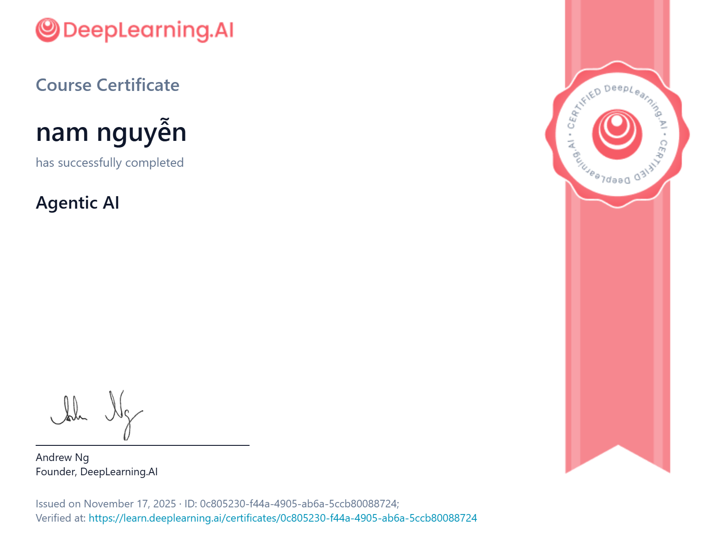

# Agentic AI Course by Andrew Ng



## 📚 Course Overview

This repository contains my learning materials, assignments, and projects from the **Agentic AI** course by Andrew Ng and DeepLearning.AI.

## ⭐ Course Review

This course is an excellent resource for updating your knowledge about **Agentic AI** with well-structured documentation by Andrew Ng. 

**My Experience:**
- The first module starts a bit slow, providing foundational concepts
- The pace picks up in later modules, covering material more quickly
- Excellent coverage of **best practices** in Agentic AI development
- Well-organized content with practical, hands-on assignments
- **Worth every penny** - highly recommended for anyone interested in building AI agents

## 📖 Course Structure

The course is divided into 5 modules covering key agentic AI design patterns:

### Module 1: Planning & Research Agent
- Building a reflective research agent with FastAPI
- Multi-step agent workflow (planner → research → writer → editor)
- Tool integration: Tavily search, arXiv, Wikipedia APIs
- Full-stack web application with Postgres database
- Task orchestration and progress tracking

### Module 2: Reflection Design Pattern
- Iterative improvement through LLM-based reflection and critique
- **Flashcards Agent**: Generate and improve study materials using reflection
- **PII Removal**: Defensive reflection for protecting sensitive information
- **SQL Agent**: Refine database queries through self-evaluation
- **Visualization Agent**: Enhance data charts using iterative critique
- Comparing reasoning vs general-purpose models for reflection

### Module 3: Tool Use Design Pattern
- Function calling and tool integration paradigms
- OpenAI function calling vs AISuite approaches
- **Email Agent**: Focused tool implementation with FastAPI UI
- **SQL Agent**: Database interaction with dynamic schema exploration
- **Research Agent**: External API tools for web search and academic research
- Introduction to Model Context Protocol (MCP) for future tool standards

### Module 4: Practical Tips for Building Agentic AI
- Evaluations(evals) and Error Analysis for Agentic AI
- Component-level evaluations
- End to end evaluations
- Latency, cost optimization
### Module 5: Multi-agent Collaboration
- Dividing complex tasks across multiple specialized agents
- **Customer Service Pipeline**: Sequential multi-agent orchestration
  - Planner → Coder → Executor → Reflector architecture
  - Error recovery and self-correction capabilities
- Agent communication patterns (linear sequences vs concurrent dialogues)
- **Final Project**: Complete agentic workflow system
  - Planning agent coordinates research, writing, and editing
  - External tool usage and feedback integration
  - Production-ready research report generation

## 🗂️ Repository Contents

```
├── Lecture_notes/          # PDF lecture materials for all modules
├── Module1/                # Introduction and planning agents
├── Module2/                # Tool-calling agents (SQL, visualization)
├── Module3/                # Advanced agent techniques
├── Module4/                # Design patterns
├── Module5/                # Capstone project
└── certificate.png         # Course completion certificate
```

Each module contains:
- **Ungraded Labs**: Practice exercises and examples
- **Graded Labs**: Assessed practical work
- **Assignments**: Module assessments with solutions
- **README files**: Additional documentation and instructions

## 🛠️ Technologies Used

- **Python** - Primary programming language
- **LangChain & AISuite** - Agent frameworks and tool orchestration
- **OpenAI API** - Language models and function calling
- **FastAPI** - Web application framework
- **PostgreSQL** - Database for state management
- **Jupyter Notebooks** - Interactive development and assignments
- **Docker** - Containerization for deployment
- **External APIs** - Tavily (web search), arXiv (academic papers), Wikipedia
- **Pydantic** - Data validation and structured outputs

## 🎓 Key Learnings

- **Reflection Pattern**: Building self-improving AI systems through critique and iteration
- **Tool Use Pattern**: Integrating external tools and APIs with LLM function calling
- **Multi-agent Collaboration**: Orchestrating specialized agents for complex workflows
- **Planning Agents**: Breaking down tasks and coordinating execution steps
- **Defensive Strategies**: Protecting against prompt injection and data leakage
- **Production Deployment**: Building production-ready agentic systems with FastAPI and Docker
- **Best Practices**: Error handling, iterative refinement, and modular agent design

## 🚀 Getting Started

Each module contains its own README with specific setup instructions. Generally:

1. Clone this repository
2. Navigate to the desired module
3. Install dependencies: `pip install -r requirements.txt`
4. Follow module-specific instructions

## 📝 Notes

This repository is for educational purposes and contains my personal work and notes from the course. The course materials are property of DeepLearning.AI.

## 🔗 Course Link

[Agentic AI by DeepLearning.AI](https://www.deeplearning.ai/)

---

**Instructor**: Andrew Ng  
**Platform**: DeepLearning.AI  
**Completion Date**: November 2025
